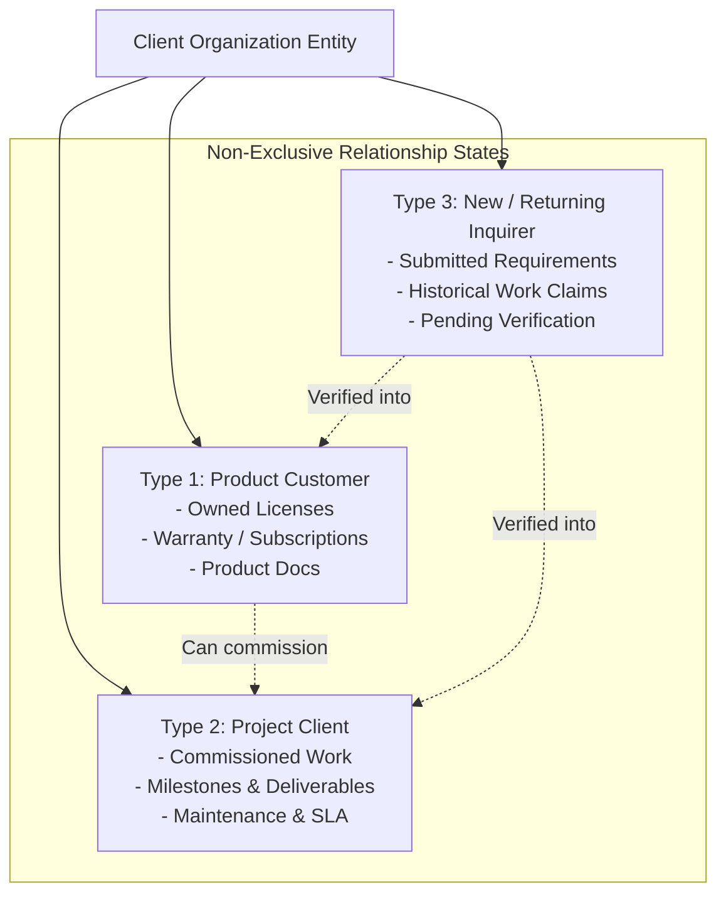
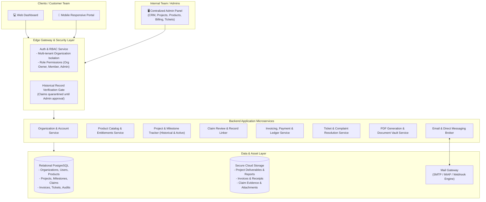
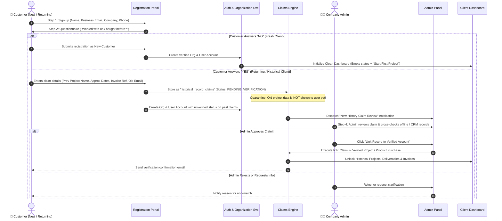
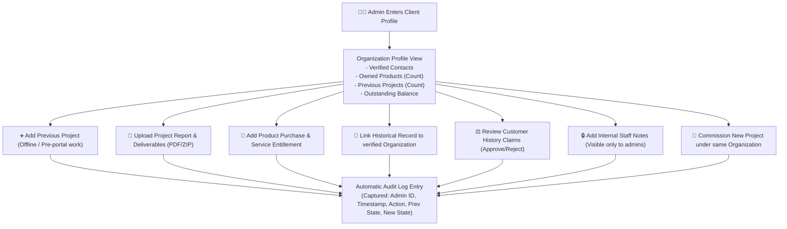
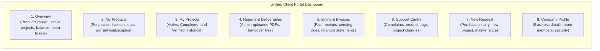
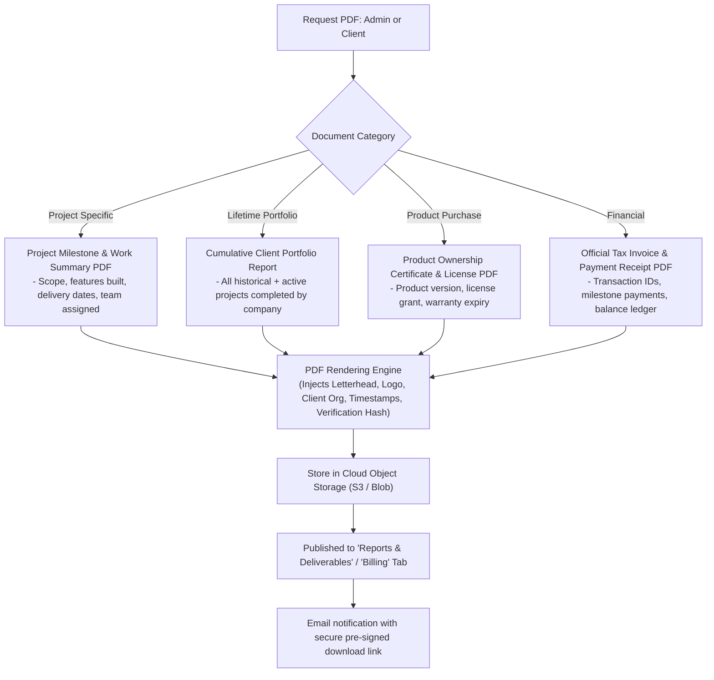
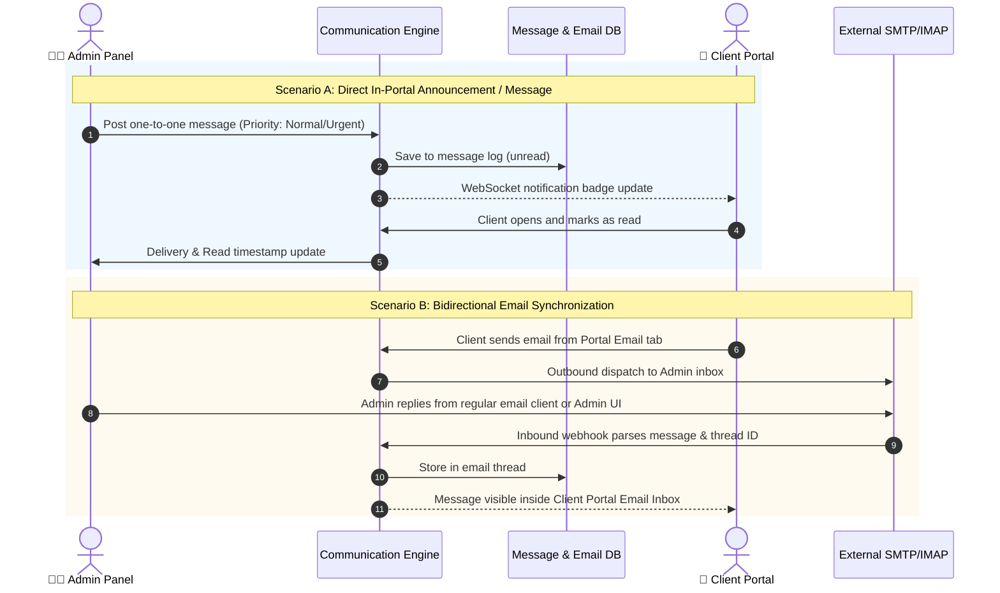

# B2B Client Portal & Admin Management System — Final Architecture & Specification

## 1. Executive Overview & Design Philosophy

This system solves the challenge of handling diverse B2B customer relationships without splintering user identities or creating redundant accounts. Instead of rigid, mutually exclusive user types, the system adopts an **Organization-Centric, Relationship-Agnostic Model**.

A single client organization can simultaneously:
1. Own off-the-shelf software or workflow **Products**.
2. Hold a ledger of previous / historical and active custom **Projects**.
3. Raise technical **Support Tickets** or product complaints tied to specific assets.
4. Commission **New Engagements** or renewals.

All of this is supported by a robust verification gate for historical records, on-demand PDF reporting, and bidirectional email/messaging.

---

## 2. Customer Relationship & State Matrix

---

## 3. High-Level System Architecture

---

## 4. Complete Customer Onboarding & Historical Claim Flow

---

## 5. Admin Panel — Customer History & Multi-Asset Management

---

## 6. Client Unified Dashboard Architecture (One Place for Everything)

### Dashboard View Matrix by Customer State:

| Section | New Customer (No History) | Product-Only Customer | Project Client (Past & Present) | Hybrid (Product + Projects) |
| :--- | :--- | :--- | :--- | :--- |
| **Overview** | Welcome banner, prompt to initiate first engagement | Active licenses summary, product health | Project progress %, active milestone tracker | Complete summary cards for both products & projects |
| **My Products** | Empty state with catalog & "Inquire Now" button | List of purchased products, license keys, documentation | Empty state (prompt to explore products) | Full list of owned products with active service tags |
| **My Projects** | Empty state with "Start Your First Project" CTA | Empty state | Active projects with % bars + Completed historical archive | Active and historical projects with milestone details |
| **Reports** | Empty state | User manuals, product compliance PDFs | Handover PDFs, architecture docs, deliverables | All project deliverables + product documentation |
| **Billing** | No records | Product invoice receipts | Milestone payment schedules, pending/paid project invoices | Unified ledger of product purchases + project invoices |
| **Support** | General inquiry form | Ticket form pre-filtered by owned products | Ticket form pre-filtered by active/past projects | Dual-mode ticket form (select either product or project) |
| **New Request** | New Project / Product quote submission | Add-on, upgrade, or custom automation request | New project scope request or maintenance contract | Unrestricted new request form |

---

## 7. Dynamic PDF Generation Engine (On-Demand & Historical)

---

## 8. Integrated Email & Direct Notification Engine

---

## 9. Comprehensive Database Architecture (Entity Relationship)

```mermaid
erDiagram
    ORGANIZATIONS ||--o{ USERS : employs
    ORGANIZATIONS ||--o{ ORGANIZATION_MEMBERS : has
    ORGANIZATIONS ||--o{ PRODUCT_PURCHASES : owns
    ORGANIZATIONS ||--o{ PROJECTS : commissions
    ORGANIZATIONS ||--o{ INQUIRIES : submits
    ORGANIZATIONS ||--o{ INVOICES : billed_to
    ORGANIZATIONS ||--o{ SUPPORT_TICKETS : raises
    ORGANIZATIONS ||--o{ HISTORICAL_RECORD_CLAIMS : declares
    ORGANIZATIONS ||--o{ AUDIT_LOGS : tracked_for

    PRODUCTS ||--o{ PRODUCT_PURCHASES : sold_as
    PRODUCTS ||--o{ SUPPORT_TICKETS : relates_to

    PROJECTS ||--o{ PROJECT_REPORTS : includes
    PROJECTS ||--o{ INVOICES : bills
    PROJECTS ||--o{ SUPPORT_TICKETS : relates_to

    INVOICES ||--o{ PAYMENTS : settles

    SUPPORT_TICKETS ||--o{ TICKET_MESSAGES : contains

    ORGANIZATIONS {
        uuid id PK
        string legal_name
        string brand_name
        string tax_id_or_gst
        string primary_email
        string phone
        string website
        string verification_status "UNVERIFIED | VERIFIED | RESTRICTED"
        timestamp created_at
    }

    USERS {
        uuid id PK
        string email UK
        string password_hash
        string full_name
        string phone
        string global_role "SUPER_ADMIN | STAFF | CLIENT"
        boolean is_active
        timestamp created_at
    }

    ORGANIZATION_MEMBERS {
        uuid id PK
        uuid organization_id FK
        uuid user_id FK
        string member_role "OWNER | BILLING_ADMIN | MEMBER"
        boolean is_primary_contact
    }

    PRODUCTS {
        uuid id PK
        string product_code UK
        string name
        text description
        string current_version
        decimal base_price
        boolean is_active
    }

    PRODUCT_PURCHASES {
        uuid id PK
        uuid organization_id FK
        uuid product_id FK
        string license_key UK
        date purchase_date
        string entitlement_type "PERPETUAL | SUBSCRIPTION | WARRANTY"
        date entitlement_end_date
        string status "ACTIVE | EXPIRED | TERMINATED"
        uuid invoice_id FK
    }

    PROJECTS {
        uuid id PK
        uuid organization_id FK
        string project_code UK
        string name
        text scope_summary
        string project_type "NEW_ENGAGEMENT | HISTORICAL_OFFLINE | AUTOMATION"
        int progress_percentage "0 to 100"
        string status "DISCOVERY | IN_PROGRESS | IN_REVIEW | COMPLETED | ARCHIVED"
        boolean is_historical_record "true if work completed before portal"
        date start_date
        date target_or_completion_date
        uuid assigned_admin_id FK
    }

    HISTORICAL_RECORD_CLAIMS {
        uuid id PK
        uuid organization_id FK
        uuid submitted_by_user_id FK
        string claim_type "PROJECT | PRODUCT_PURCHASE"
        string declared_name
        string declared_reference_number
        string declared_old_email
        date approximate_date
        text notes
        string verification_status "PENDING | APPROVED | REJECTED"
        uuid verified_by_admin_id FK
        timestamp verified_at
        text admin_decision_notes
    }

    PROJECT_REPORTS {
        uuid id PK
        uuid project_id FK
        string title
        string document_type "DELIVERABLE | HANDOVER_SUMMARY | ARCHITECTURE_DOC | AUDIT_REPORT"
        string file_url
        string file_size
        string version "e.g. v1.0, v2.1"
        uuid uploaded_by_admin_id FK
        timestamp uploaded_at
    }

    INVOICES {
        uuid id PK
        uuid organization_id FK
        uuid project_id FK "Nullable if Product Invoice"
        string invoice_number UK
        decimal subtotal
        decimal tax_amount
        decimal total_amount
        decimal balance_due
        date due_date
        string status "DRAFT | ISSUED | PARTIAL | PAID | VOID"
        string invoice_pdf_url
    }

    PAYMENTS {
        uuid id PK
        uuid invoice_id FK
        decimal amount
        string payment_method "BANK_TRANSFER | CARD | UPI | MANUAL"
        string transaction_reference
        timestamp paid_at
        string receipt_pdf_url
    }

    SUPPORT_TICKETS {
        uuid id PK
        uuid organization_id FK
        uuid created_by_user_id FK
        uuid project_id FK "Nullable if Product Issue"
        uuid product_id FK "Nullable if Project Issue"
        string ticket_code UK
        string subject
        string priority "LOW | MEDIUM | HIGH | CRITICAL"
        string status "OPEN | IN_PROGRESS | WAITING_CLIENT | RESOLVED | CLOSED"
        timestamp created_at
        timestamp resolved_at
    }

    TICKET_MESSAGES {
        uuid id PK
        uuid ticket_id FK
        uuid sender_user_id FK
        text message_body
        string attachment_url
        boolean is_internal_note "true for staff-only comments"
        timestamp sent_at
    }

    INQUIRIES {
        uuid id PK
        uuid organization_id FK
        uuid user_id FK
        string request_type "NEW_PROJECT | PRODUCT_PURCHASE | ENHANCEMENT | MAINTENANCE"
        string title
        text requirements_description
        decimal budget_estimate
        string status "NEW | IN_REVIEW | PROPOSAL_SENT | CONVERTED | REJECTED"
        timestamp submitted_at
    }

    AUDIT_LOGS {
        uuid id PK
        uuid organization_id FK
        uuid actor_user_id FK
        string action "RECORD_LINKED | CLAIM_APPROVED | PROGRESS_UPDATED | INVOICE_GENERATED"
        string entity_name
        uuid entity_id
        jsonb previous_state
        jsonb new_state
        timestamp performed_at
    }
```

---

## 10. System Enforcement Rules & Guarantees

1. **Organization-Level Isolation:** Every user belongs to one or more `organizations`. Data is queried using `WHERE organization_id = :org_id`. Cross-organization visibility is strictly blocked at the API gateway layer.
2. **Historical Claims Quarantine:** Any previous work entered during onboarding is tagged `PENDING` in `historical_record_claims`. It is strictly invisible on the client's dashboard until an authorized Admin checks offline records, verifies authenticity, and clicks **Approve & Link**.
3. **No Duplicate Identity Creation:** If a client commissions 5 new projects over 3 years and buys 2 off-the-shelf products, everything stays under the identical Organization profile.
4. **Historical != Active:** Previous work loaded into the system (whether pre-portal offline work or completed projects) maintains status `COMPLETED / HISTORICAL`. They do not consume active project slots unless a new `INQUIRY` is converted into an active project engagement.
5. **Contextual Support Routing:** When a client opens the Support Centre, the dropdown asks: *"What is this related to?"* and populates only their verified owned Products and Projects, ensuring tickets are tied directly to root assets.
6. **Immutable Audit Trail:** All manual historical insertions, claim approvals, progress adjustments, and financial overrides log an immutable record to `audit_logs` capturing the actor, exact timestamp, and payload diff.
