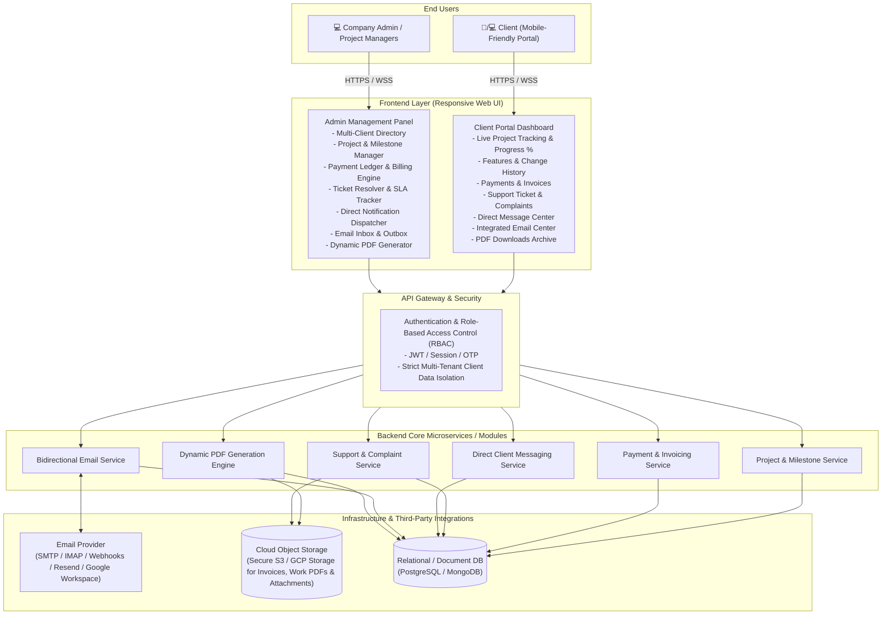
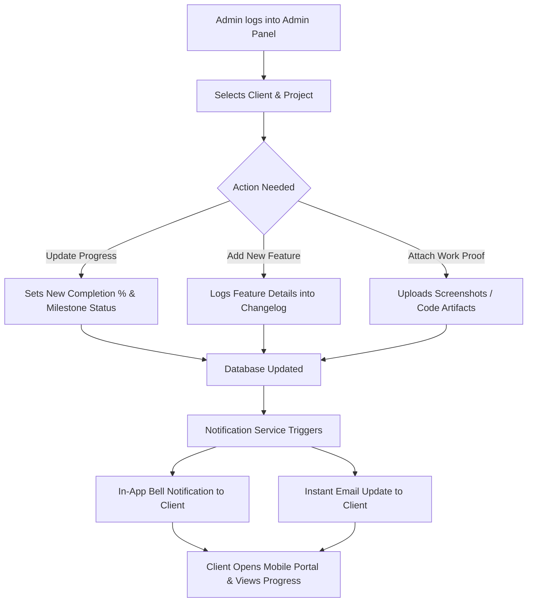
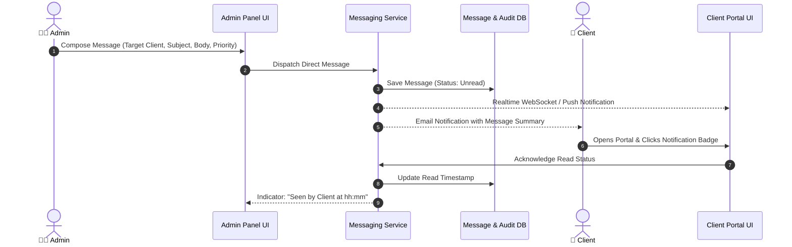
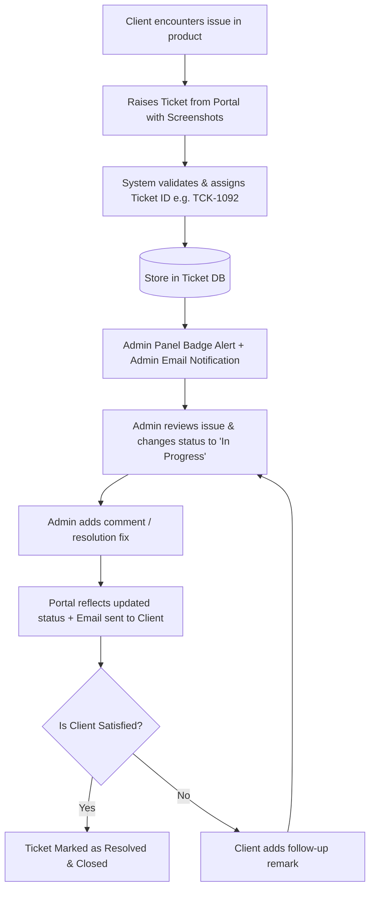
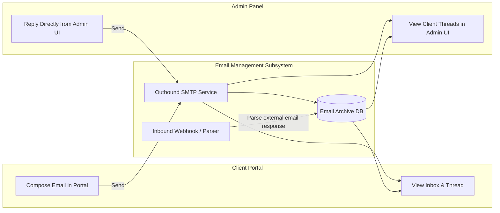
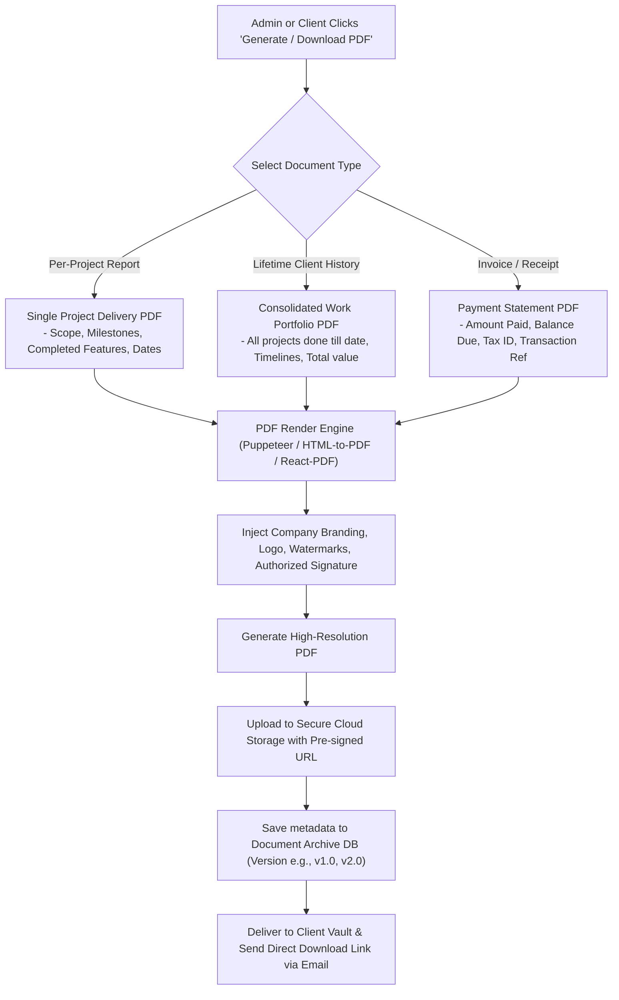
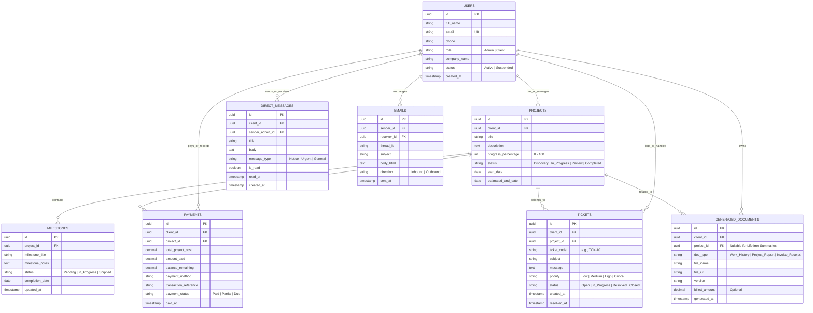

# Client Portal & Admin Management System Architecture

## 1. Executive Summary & Objective
Yeh architecture document ek comprehensive, mobile-friendly **Client Portal** aur **Admin Management Dashboard** ka complete blueprint provide karta hai. Is system se client apne sabhi projects ka live progress, payment history, feature changelog, support tickets, direct email communication aur dynamically generated PDF reports (work history & invoices) track kar sakta hai. Admin panel se company client ke sabhi works, updates, messages aur billings ko centralized manage kar sakti hai.

---

## 2. High-Level System Architecture

---

## 3. Module-by-Module Functional Specifications

### 3.1. Client Portal (Mobile-First Experience)
- **Overview Dashboard:** Total projects count, active project progress bar (`0%` to `100%`), payment status badge (Paid / Remaining), recent updates feed.
- **Project Progress & History:** Milestones timeline, newly implemented features, completed deliverables, historical changelog.
- **Payments & Invoicing:** Complete list of past payments, pending dues, transaction references, direct PDF receipt downloads.
- **Support & Complaint Center:** Form to raise new issues with attachments (screenshots/docs), ticket priority, real-time status updates (Open, In Review, In Progress, Resolved).
- **Direct Messages & Notifications:** In-app alert bell, announcements from admin, read/unread status.
- **Integrated Email Client:** Dedicated tab to compose and view email threads directly within portal without leaving dashboard.
- **Document Vault:** Organized repository of all generated Work Summary PDFs, Contracts, Handover Reports and Invoices.

### 3.2. Admin Management Panel
- **Client Management (CRM):** Onboarding new clients, setting access credentials, assigning projects.
- **Milestone & Progress Manager:** Updating completion %, marking features as shipped, writing milestone update notes.
- **Financial Ledger & Billing:** Recording received payments, logging balance amounts, triggering auto-calculated invoices.
- **Issue & Ticket Management:** Assigning complaints, replying to client tickets, resolving tickets.
- **Direct Message Dispatcher:** Sending targeted notices or urgent announcements to individual clients or all clients.
- **Email Synchronization:** Direct view of emails sent to/from clients with full thread history.
- **PDF Generation Suite:** On-demand creation of individual project reports, consolidated client lifetime work reports, and invoice receipts.

---

## 4. End-to-End Workflow Diagrams

### 4.1. Project Milestone & Progress Update Flow

---

### 4.2. Direct Messaging & Announcement Flow

---

### 4.3. Support / Complaint Ticketing System Flow

---

### 4.4. Integrated Bidirectional Email System

---

### 4.5. Dynamic PDF Generation & Work History Architecture

---

## 5. Database Schema Design (Entity Relationship)

---

## 6. Security, Access Control & Privacy
1. **Multi-Tenant Data Isolation:** Har client ko sirf uske records (Projects, Tickets, Messages, PDFs) visible honge. Database queries mein `client_id` mandatory filter rahega.
2. **Role-Based Access Control (RBAC):**
   - **Client Role:** Read-only access to projects/invoices; Write access to create tickets and send emails/messages.
   - **Admin Role:** Full CRUD access to clients, projects, payments, ticket resolution, and PDF generation.
3. **Protected PDF Assets:** Generated PDFs public bucket mein nahi honge; unhein Pre-signed secure URLs (time-limited expiry) se deliver kiya jayega.
4. **Audit Logging:** Har milestone update, payment addition aur message dispatch ka immutable timestamped audit log maintain hoga.
